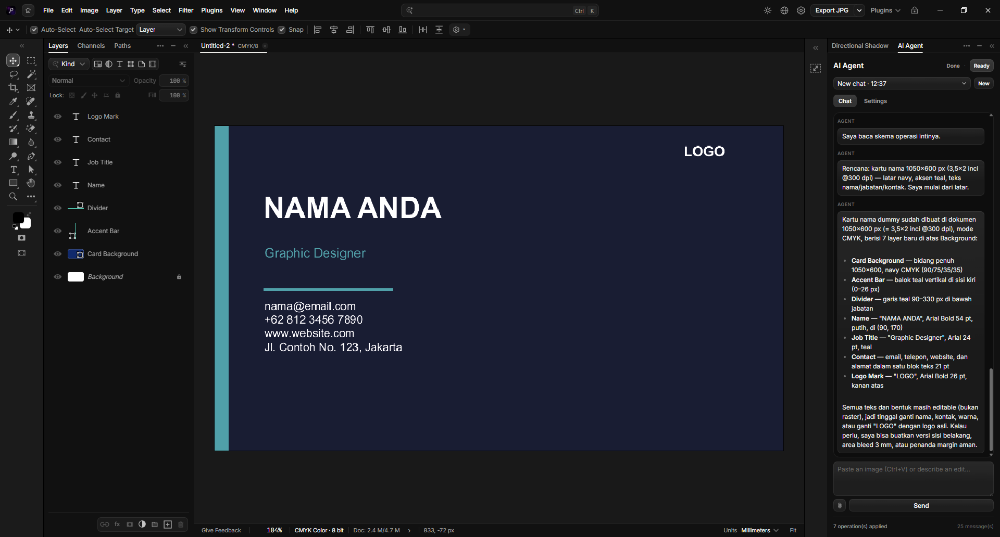
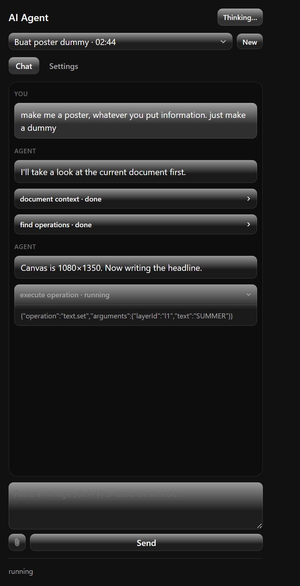
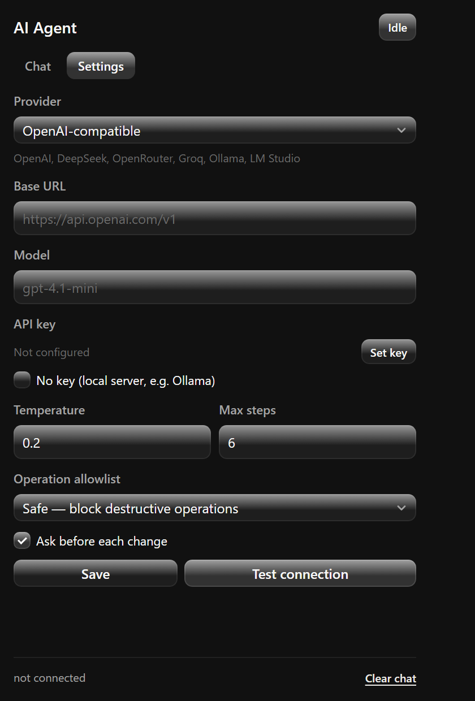

# Photon LLM Interface

Bring-your-own-key AI agent for Photon Studio. Paste an API key, pick a provider and model, then ask
for edits in plain language — the plugin runs the agent loop itself and drives Photon through four
meta-tools, so no third-party harness is involved.

Supports OpenAI-compatible endpoints (DeepSeek, OpenRouter, Groq, Together, Mistral, Ollama, any
custom base URL), Anthropic and Gemini.

## Screenshots

| Chat with the agent process block | Settings and API key |
| --- | --- |
|  |  |

## Design system

Panel styling, components and tokens follow [`../design-system`](../design-system/README.md):
24 px controls, 7 px control radius, 12 px floating surfaces, the canonical `select.js`
dropdown and the shared header/footer contract.

## Install

1. Photon Studio → **Preferences → Plug-ins → Install plugin** → select this repository's
   `plugin/` folder.
2. Open the panel from **Plugins → AI Agent** (`Ctrl+Shift+A`).
3. In **Settings**, choose a provider, paste the API key and press **Configure key** (stored in
   Photon's credential vault, never in settings files), then **Test connection**.
4. Back in **Chat**, describe the edit and send.

## What it can do

- **Chat** with streaming replies, markdown rendering, and a live process block that groups the
  operations the agent runs.
- **Image attachments** (paperclip or `Ctrl+V`): PNG/JPEG/WebP/GIF up to 1 MB, auto-compressed down
  a 1568 → 256 px ladder, max four per message.
- **Document context**: the agent reads the active document, finds and describes operations, then
  executes them one `documents.transaction` at a time, with an allowlist and optional confirmation.
- **Conversations** kept in plugin settings with hard caps (20 conversations, 60 messages,
  ~700 KB), export/import, and a debounced writer so saving never blocks the UI.

## Configuration

| Setting | Notes |
| --- | --- |
| Provider / Base URL / Model | Any listed provider, or a custom OpenAI-compatible base URL |
| API key | Stored via `credentials.configure`, origin-bound to the provider |
| Temperature, Max steps | Loop budget and sampling controls |
| Operation allowlist | Restrict which operation namespaces the agent may run |
| Confirm before executing | Ask before each write (recommended) |

Agent safety: `document.close/resize/resample/crop`, `layer.delete`, `session.*`, `file.*`,
`plugins.*` and `preferences.*` are always denied; only the active conversation reaches the model.

## Testing

```powershell
node tools/agent-test.cjs       # 24 tests: loop, allowlist, confirm, adapters, images, history
node tools/markdown-test.cjs    # 10 tests: formatting, escaping, link safety
node tools/store-test.cjs       # 17 tests: conversations, caps, isolation, import/export
node tools/images-test.cjs      # 13 tests: mime detection, 1 MB ladder, clipboard items
node tools/saver-test.cjs       #  6 tests: debounced writer
node tools/llm-bench.cjs        # markdown, JSON, store and writer timings
```

70 tests, no Photon and no API key required.

## Changelog

### 0.4.6

- Fixed the startup crash: the Details/copy footer element references were missing from the
  panel's element map, so `wireFooter()` called `addEventListener` on `undefined`.

### 0.4.5

- Removed the duplicate hairline above the footer: the old `.footer-actions` rule no longer adds
  its own border inside the shared footer.

### 0.4.4

- Details overlay now has a **copy all logs** icon (system clipboard, with a textarea fallback).

### 0.4.3

- Footer follows the shared plugin pattern: version left, `Details` and `Check service` right.
  Details shows a local log; Check service reports the document, provider, model and key state.

### 0.4.2

- Chat/Settings tabs use the canonical `tabs.js` slider (220 ms ease); the transcript and
  settings views are unchanged.

## Limits

- Conversations are JSON in plugin settings (no SQLite in the webview); history beyond the caps is
  trimmed oldest-first.
- Only operations exposed to plugins are reachable — file dialogs, preferences and other plugins are
  not.
- The provider must allow browser-style requests from the plugin sandbox; keys never leave the
  credential vault.

MIT licensed — see [LICENSE](LICENSE).
